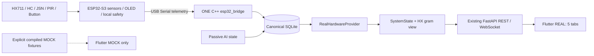
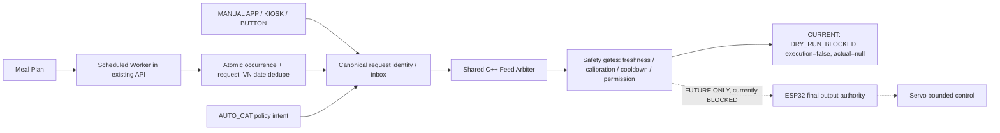
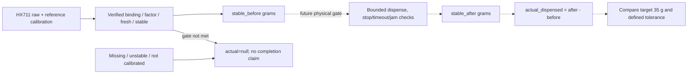
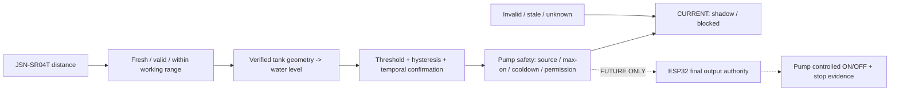

# ARCHITECTURE OVERVIEW — checkpoint26/10/2026

Kiến trúc hiện có được giữ nguyên. Mermaid chỉ để vẽ tài liệu; ASCII ngay dưới mỗi hình dùng khi renderer không hỗ trợ.
**Đường telemetry/inference và DRY RUN đã có; đường execution vật lý bên phải gate là mục tiêu bị BLOCKED, không phải pipeline đã cấp thật.**
FastAPI Python là control plane/API/scheduling; inference và serial bridge chạy C++. Không tạo Python inference runtime thay detector.

## A. Camera / OpenCV / TensorRT / YOLO / CAT-DOG-NONE


```text
Camera -> OpenCV C++ -> TensorRT -> YOLO detection/postprocess -> CAT/DOG/NONE
                                                           -> passive ai_state_tap -> SQLite
```

TensorRT **thực thi YOLO engine**, không phải hai model nối tiếp. CAT/DOG là class của detector; NONE là không có detection chấp nhận được.
Health không hợp lệ/mất inference phải là UNKNOWN với consumer. Không đồng nghĩa định danh cá thể hay behavior eating.
Model/engine/binary production không thay trong RC; không đo accuracy/FPS mới.

## B. ESP32 sensors / bridge / SystemState / REST-WS / Flutter



```text
ESP32 Sensors -> USB Serial -> ONE C++ Bridge -> same SQLite -> RealHardwareProvider
AI state ------------------------------------> same SQLite -> SystemState
SystemState -> existing REST/WebSocket -> Flutter REAL
explicit fixtures --------------------> separately compiled Flutter MOCK
```

Không có REAL→MOCK fallback. Backend/link/sensor lỗi giữ missing/null/UNKNOWN hoặc trạng thái lỗi đúng scope, không fake values.
OLED và safety MCU không phụ thuộc Flutter giữ kết nối. Chỉ một reader serial, camera detector không bị tap mở lại.

## C. Intent / Feed Arbiter / Safety Gates / ESP32 / Servo



```text
MANUAL / SCHEDULED / AUTO_CAT -> Feed Arbiter -> Safety Gates
                                                 |-> CURRENT: DRY RUN / BLOCKED
                                                 `.. FUTURE/BLOCKED -> ESP32 -> Servo
```

Worker không có đường mở servo riêng; BUTTON cũng không bypass arbiter. Local MCU giữ final output permission; Jetson arbiter không thay bảo vệ MCU.
Current safe-mode outputs0/disarmed; missing telemetry không là bằng chứng GPIO OFF. Không có command actuation mới được RC cấp phép.

## D. HX711 / stable_before / dispense / stable_after / actual35g



```text
HX711 -> valid calibrated/stable grams -> stable_before
      .. [PHYSICAL EXECUTION CURRENTLY BLOCKED] .. dispense -> stable_after
      .. actual_dispensed = stable_after - stable_before -> compare target35g
missing/invalid/unstable/unverified ---------------------> actual=null
```

Đây là thiết kế closed-loop chuẩn bị, **chưa có proof cấp thật35g**. Khối lượng trong bát và servo runtime không phải actual.
FIT candidate không là active calibration; phải verify độc lập và persistence. Nếu có mèo ăn/lực ngoài trong khi đo, delta có thể không đại diện lượng cấp, cần loại/ghi invalid.

## E. JSN / level / thresholds-safety / pump



```text
JSN -> valid distance -> geometry -> water level -> threshold/hysteresis/safety
                                               |-> CURRENT: shadow/BLOCKED
                                               `.. FUTURE/BLOCKED -> ESP32 -> Pump
```

JSN ranging pass không là geometry/threshold hay flow pass. AUTO_WATER=false; pump chưa controlled physical test, #2 còn NOT_WIRED ở checkpoint.

## Ranh giới trách nhiệm và nguồn sự thật

| Thành phần | Trách nhiệm | Không được suy ra |
|---|---|---|
| AI C++/TensorRT | Detection, timestamp/health | CAT không tự cấp quyền servo |
| ESP32 | Sensor I/O, OLED/button, final output gates | Đã đấu không là motion/flow pass |
| C++ bridge/arbiter | Một serial owner, parse/bounds, request policy | Dry-run receipt không là completed feeding |
| SQLite | Durable identities/plans/occurrences/calibration metadata | Có row không là physical outcome |
| FastAPI/SystemState | API/WS + worker hiện có, measurement view | Unknown không tự thành0/false |
| Flutter | Hiển thị, user intent, typed validation/history dedupe | Không tạo sensor value hoặc calibration command |

Current status: [PROJECT_STATUS_20261026.md](PROJECT_STATUS_20261026.md).
Order/gates cho phiên sau: [NEXT_PHYSICAL_SESSION.md](NEXT_PHYSICAL_SESSION.md).
