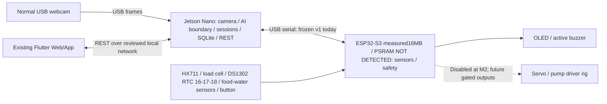

# Final system block diagram

**NO STM32. NO ESP32-CAM. NO AI CAMERA REQUIRED.** Webcam is ordinary USB; Jetson owns future AI inference. ESP32-S3 handles sensors and final actuator safety. User-reported chip/flash/USB/webcam results now exist; PSRAM NOT DETECTED overrides seller N16R8. Actual GPIO/voltage/sensor/actuator wiring and frontend remain unverified; diagram arrows do not prove those tests occurred.

Current state: `CURRENT_PROJECT_STATE.md`; handoff/freeze: `PRE_HARDWARE_HANDOFF.md`. HX711/RTC/ultrasonic/OLED/button/buzzer are MCU peripherals; servo/pump paths remain physically disabled. Classic regression profiles are not a second current architecture.

Hardware observations now exist within the user-reported scopes in `M3_PHYSICAL_VALIDATION_RECORD.md`; seller N16R8 is legacy/unverified advertising, not current memory selection. Candidate sensor pins still need physical wiring/voltage tests; no M4 or full-system success follows from diagram arrows.

RTC hardware changed from planned DS3231 to available DS1302 during M4 physical bring-up. DS1302CLK16/DAT17/CE18uses3-wire,OLEDaloneusesI2CSDA8/SCL9; noexpectedRTC0x68. PhysicalRTCvalidationnotperformed.
