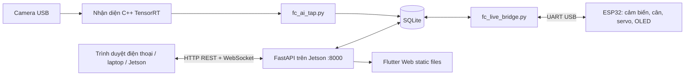

# Kiến trúc phần web FOR CAT

## Luồng dữ liệu thực tế

Frontend dùng Flutter/Dart, `http` và `web_socket_channel`. FastAPI/Pydantic cung cấp REST API và luồng trạng thái WebSocket. SQLite lưu dữ liệu, lịch và hàng đợi yêu cầu. Bridge thiết bị hoạt động ở tiến trình riêng; trình duyệt không truy cập GPIO/UART trực tiếp. AI đang triển khai là detector C++ TensorRT, kết quả được bộ tap Python đưa vào SQLite. Các adapter AI/camera khác trong source là phần mở rộng, không đồng nghĩa tất cả đã được triển khai.

## Ánh xạ mã nguồn frontend

| Tệp | Vai trò |
|---|---|
| `lib/main.dart` | Khởi tạo ứng dụng, theme và các tab |
| `lib/user_pages.dart` | Các trang người dùng |
| `lib/ui_widgets.dart` | Thành phần giao diện dùng chung |
| `lib/backend_factory.dart` | Chọn REAL hoặc MOCK qua dart-define |
| `lib/real_backend.dart` | HTTP, WebSocket, kết nối lại, theo dõi dữ liệu cũ |
| `lib/feeder_state.dart`, `status_model.dart` | Mô hình dữ liệu trạng thái |
| `lib/meal_plans.dart`, `meal_plan_panel.dart` | Mô hình và giao diện lịch ăn |
| `lib/history_model.dart` | Mô hình lịch sử |
| `lib/pending_store*.dart` | Lưu yêu cầu đang chờ theo môi trường trình duyệt |
| `lib/live_camera*.dart` | Thành phần camera và xử lý trạng thái luồng |
| `lib/diagnostics_page.dart`, `diagnostic_models.dart` | Chi tiết hệ thống/chẩn đoán |
| `lib/mock_backend.dart` | Dữ liệu tình huống mô phỏng có nhãn |

Giao diện gồm Tổng quan, Cho ăn, Lịch sử, Hệ thống và Cài đặt. Tính năng camera có giao diện và mô hình trạng thái; cần căn cứ API camera thực sự khả dụng khi mô tả một phiên triển khai cụ thể.

## Ánh xạ backend

| Tệp / thư mục | Vai trò |
|---|---|
| `app/main.py` | Tạo FastAPI app, đăng ký route, vòng đời và static Flutter |
| `app/config.py` | Đọc, kiểm tra cấu hình môi trường |
| `app/api/` | Các endpoint REST/WebSocket |
| `app/system_state.py`, `device_state.py`, `ai_state.py` | Tổng hợp trạng thái và kiểm tra độ mới |
| `app/storage/` | SQLite event store và repository |
| `app/meal_plans.py` | Lưu/sửa/xóa lịch theo revision, ngày trong tuần và múi giờ |
| `app/scheduled_worker.py` | Tạo một lượt theo plan_id + thời điểm đã đặt; chống trùng |
| `tools/fc_live_bridge.py` | Gửi/nhận UART, đồng bộ AI và dữ liệu ESP32 |
| `tools/fc_ai_tap.py` | Nhận nhãn CAT/DOG/NONE từ stdout của detector |
| `tools/run_api.py` | Entrypoint khởi động API |

## Luồng cho ăn và hẹn giờ

1. Frontend gửi yêu cầu đến API; API ghi hàng đợi SQLite theo request_id.
2. Bridge đọc hàng đợi và chuyển lệnh đến ESP32. Lịch hiện tại dùng `feed_once <request_id>` với ACK và chống thực thi lặp trên MCU.
3. ESP32 điều khiển servo và đo loadcell; Jetson tiếp nhận trạng thái/kết quả.
4. ACK chỉ xác nhận nhận lệnh/khởi động lượt, chưa chứng minh đã cấp đủ thức ăn.
5. `WEIGHT_REACHED`, `FAILED`, `UNCERTAIN` là các trạng thái giao nhận bổ sung. `measured_at_close_g` là số đo kích hoạt đóng; không tự coi là khối lượng cuối cùng đã được xác minh chính xác.

Worker dùng giờ Jetson, múi giờ Việt Nam. Chỉnh một lịch sang giờ khác trong cùng ngày tạo slot mới; gửi lại cùng slot không cấp thêm một lượt. Cửa sổ thực thi hiện tại là một phút, không tự cấp bù mọi lịch cũ đã bỏ lỡ. Bridge xác nhận giờ hệ thống trước khi xử lý lịch sau khởi động.

## Truy cập web

- Trên Jetson: `http://127.0.0.1:8000/app` dùng dịch vụ ngay trong máy.
- Trong LAN: `http://<IP-hiện-tại-của-Jetson>:8000/app`; IP đổi khi đổi router/mạng.
- Ngoài LAN: thiết bị đã được cấp quyền và kết nối Tailscale truy cập đường HTTPS riêng của Jetson.

Tailscale là lớp truy cập mạng; không phải bằng chứng ứng dụng có hệ thống tài khoản/đăng nhập riêng. Web offline trên Jetson vẫn cần máy chủ chạy và toàn bộ tài nguyên đã được phục vụ cục bộ.

## Phạm vi cần ghi đúng trong báo cáo

- Bốn cảm biến thực tế là HC-SR04: E1 mèo12/13, E2 hộp thức ăn16/17, D1 chén nước14/15, D2 bình nước18/19. Metadata backend cũ còn ID JSN, role TBD và D2 echo10; cần nêu đây là nhãn tương thích còn tồn tại, không sử dụng chúng làm sơ đồ chân PCB cuối cùng.
- Việc hiệu chuẩn phần trăm nước và chạy bơm tự động chưa được hoàn tất trong các phiên gần đây. Không mô tả mọi giá trị phần trăm hiện lên web là phép đo dung tích đã được hiệu chuẩn.
- Logic hiện tại có chế độ dự phòng trên ESP32 khi mất heartbeat Jetson. Phần nguồn độc lập và kiểm thử cúp điện thực tế còn chờ lắp nguồn; web/AI trên Jetson không tiếp tục chạy nếu Jetson mất nguồn.
- Mốc đóng/mở servo là tương đối theo xung và thời gian, không có phản hồi công tắc hành trình. Ngưỡng cân35g ra lệnh đóng không bảo đảm khối lượng cuối cùng đúng tuyệt đối35g.
- Tên `DRY_RUN`, `actuator_execution=false` trong một số payload là hợp đồng lịch sử còn giữ để tương thích Flutter. Bridge triển khai hiện tại có gửi lệnh thực; nên mô tả dựa trên luồng code/ACK/kết quả, không dựa riêng tên biến.
- Ảnh `giao_dien_web_20261106.png` nếu có là ảnh kiểm tra giao diện phiên06/11, không đại diện số đo tại thời điểm viết báo cáo. MOCK cần được chú thích rõ.

## Bố cục gợi ý cho chương báo cáo web

1. Yêu cầu chức năng và vai trò web trong hệ thống.
2. Kiến trúc Flutter–FastAPI–SQLite–UART–ESP32 và luồng AI.
3. Thiết kế các tab, mô hình dữ liệu và REST/WebSocket.
4. Cơ chế lịch, request_id/revision, chống trùng và trạng thái nhận lệnh/kết quả.
5. Triển khai local, LAN, Tailscale và sử dụng trên màn hình Jetson.
6. Kiểm thử giao diện, mất kết nối, dữ liệu cũ và các giới hạn thực nghiệm.
