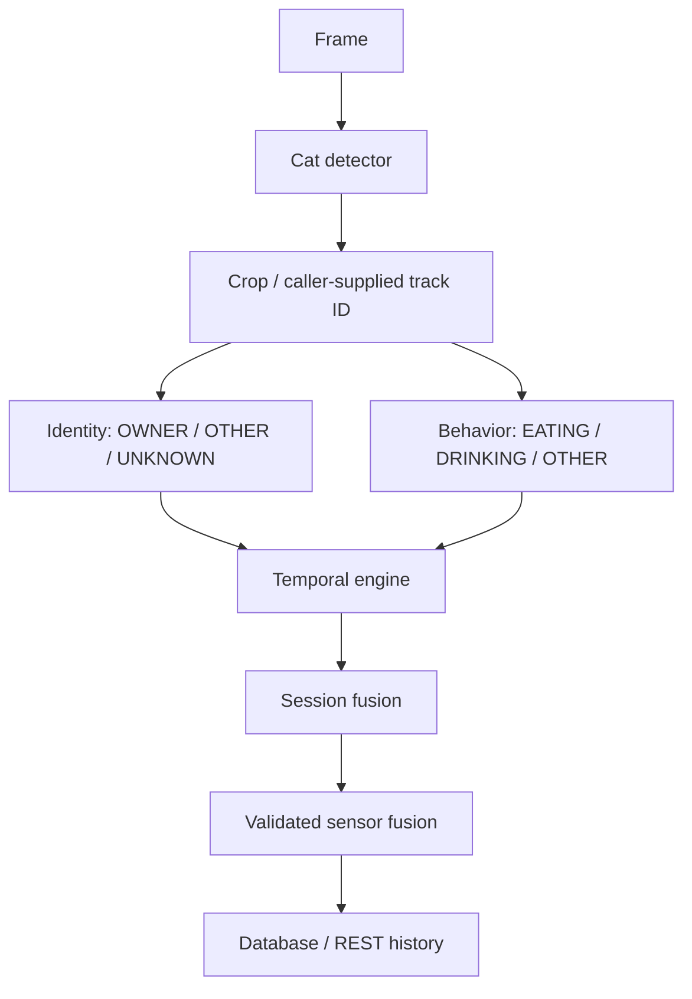

# AI task architecture — conceptual boundary frozen, models untrained

OTHER_OBJECT is a negative identity-training class; no detection/ambiguous input may yield UNKNOWN/NO_SUBJECT at runtime. Crop geometry, channel conversion and confidence rejection must be explicit. Separate detector, identity and behavior components allow different data, evaluation, budgets and deployment choices; one giant model is not required.

Implemented boundaries: `app/vision/detector.py`, `tracking.py`, `app/ai/{interfaces,runtime,pipeline,service}.py`, `behavior/{temporal,fusion}.py`. The detector adapter is injected, not bundled; current temporal engine has one active session, not multi-track engines. TrackLedger preserves supplied IDs/first_seen/last_seen with TTL/budgets; it does not associate detections or perform Re-ID. Future integration requires one temporal state per subject track and reviewed ROI assignment.

Attribution: OWNER only may produce clean owner evidence; OTHER only is observed without owner authority; OWNER+OTHER, multiple OTHER, unknown identity or overlap are AMBIGUOUS by default. Existing detector adapter rejects multiple detections. Ambiguous sessions cannot become clean preference trials. No AI path authorizes feeding in this candidate; shadow mode remains true.

Candidate configs: `ai/registry/candidates.json` (YOLO-light/SSD-MobileNet, ResNet18/MobileNetV3/Re-ID option, frame/temporal/video options). Input sizes/complexities are conceptual configurations, not measurements. No models were downloaded; no Jetson FPS exists.
