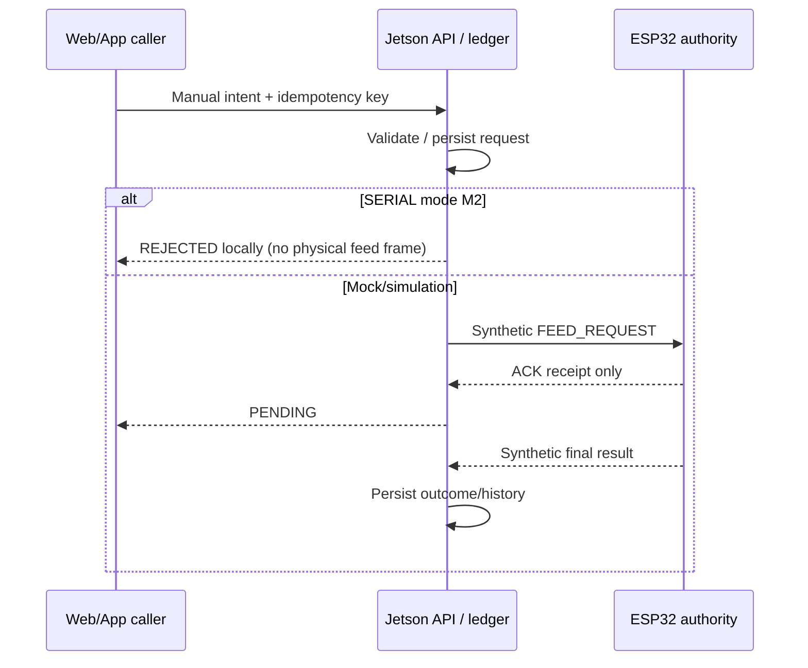
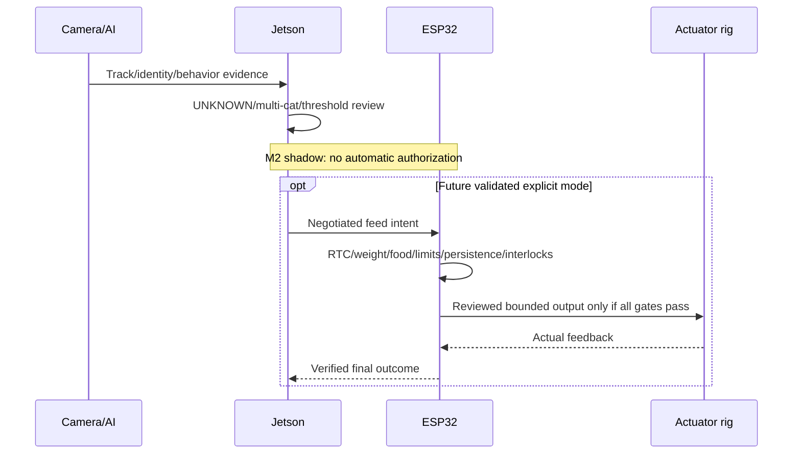
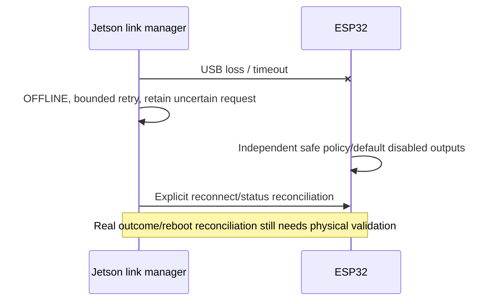
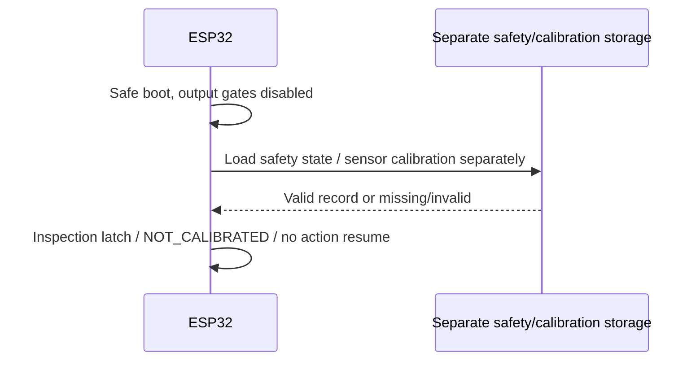

# Sequence diagrams — current software and future gated actions

## Manual Feed (current safe behavior)


## Automatic Feed candidate (future only)


## Eating observation
```mermaid
sequenceDiagram
  participant C as Frame/crop/track
  participant T as Temporal engine
  participant F as Session/sensor fusion
  participant D as Database/API
  C->>T: Supplied identity/EATING/ROI/confidence/time
  T->>T: Confirm positives / bound dropout
  T->>F: START then END at last positive evidence
  F->>F: Associate subject/feed; validated stable weights or null
  F->>D: Typed visit/history, no feeding action
```

## Drinking observation
```mermaid
sequenceDiagram
  participant C as Frame/track
  participant T as Temporal engine
  participant D as Database/report
  C->>T: Supplied DRINKING/water ROI evidence
  T->>T: Confirm / reject ambiguity / end on dropout
  T->>D: Drinking start/end/duration
  Note over D: Volume unknown; no diagnosis
```

## Serial loss


## ESP32 reboot


## Jetson reboot
```mermaid
sequenceDiagram
  participant J as Jetson service
  participant D as SQLite ledger/history
  participant E as ESP32 link
  J->>D: Restore persisted request/session state
  J->>J: Default MOCK/shadow; observation worker not auto-started
  opt Explicit future serial configuration
    J->>E: Passive bounded status/reconciliation
  end
  Note over J,E: No blind resend of uncertain feeding; no model auto-activation
```
