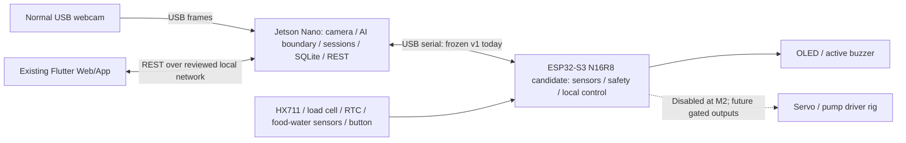

# Final system block diagram

**NO STM32. NO ESP32-CAM. NO AI CAMERA REQUIRED.** Webcam is ordinary USB; Jetson performs future AI inference. ESP32-S3 handles sensors and final actuator safety independently. Existing frontend is outside this tree. Seller N16R8 board and actual wiring remain candidates/unverified. No block arrow proves a deployed physical connection.

Current state: `CURRENT_PROJECT_STATE.md`; handoff/freeze: `PRE_HARDWARE_HANDOFF.md`. HX711/RTC/ultrasonic/OLED/button/buzzer are MCU peripherals; servo/pump paths remain physically disabled. Classic regression profiles are not a second current architecture.
